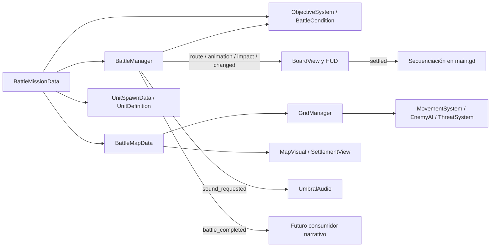

# Arquitectura real de UMBRAL

## Actualización: ciclo narrativo

El menú normal ahora ofrece Iniciar historia, que instancia `scenes/exploration.tscn` mediante StorySession y contenido de `data/narrative/settlement.json`. El selector de fixtures sigue existiendo oculto para tests; no hay selección jugable 10×10. MissionFlowController coordina WorldState → preparación independiente → secuencia → BattleManager existente → resultados/reintento. NeutralAI añade una fase neutral entre enemigos y aliados solo si existen neutrales móviles. Los recursos base siguen siendo de solo lectura. Ver EXPLORATION.md, NARRATIVE_SYSTEM.md, CREATING_MISSIONS.md e ITERATION3.md para contratos y pruebas; las secciones siguientes conservan la descripción de los sistemas tácticos.

Godot 4.2.2, GDScript tipado, renderizador Compatibility. Consultar primero `AGENTS.md`. Esta documentación describe la implementación existente; la auditoría anterior al cambio está en `ARCHITECTURE_AUDIT.md`. El procedimiento de creación de contenido está en `CREATING_MAPS.md` y los resultados de validación en `ARCHITECTURE_TESTING.md`.

## Escenas y ciclo de ejecución

`project.godot` ejecuta **`scenes/main.tscn`**, un Control con `scripts/main.gd`. El controlador compone el menú, el HUD, BoardView y los diálogos por código. No existen escenas de combate diferentes para cada misión ni se ha inventado una escena Battle.tscn: ambos escenarios utilizan `start_battle(mission)` y exactamente el mismo controlador.

El menú consulta `MissionCatalog.missions()`, que descubre recursos BattleMissionData en `data/missions/`. El OptionButton guarda el recurso seleccionado. Iniciar crea un BattleManager nuevo con esa misión; reiniciar conserva la elección y crea estado nuevo. Volver al menú mantiene la elección, pero no conserva PV, acciones, captura ni corrutinas de la partida anterior.

La presentación del asentamiento es la escena reutilizable **`scenes/maps/settlement_visual.tscn`**, con SettlementView. El mapa de prueba deja `visual_scene` vacío y usa MapVisual, la presentación genérica. Son vistas ambientales, no implementaciones de combate.

## Configuración y estado

Los recursos de configuración se tratan como **solo lectura durante una batalla**. Las unidades y los gestores mantienen su propio estado mutable. Dos batallas pueden compartir la misma misión sin compartir PV, enfriamientos, fases, captura o el array de obstáculos de GridManager.

| Dato | Archivo/clase | Contenido |
|---|---|---|
| Mapa | `scripts/data/battle_map_data.gd` / BattleMapData | ID, dimensiones, tamaño de casilla, origen visual opcional, whitelist transitable, bloqueos, terreno, puntos de aparición y PackedScene visual |
| Misión | `scripts/data/battle_mission_data.gd` / BattleMissionData | ID/nombre, mapa, participantes, objetivo textual, unidad protegida, umbral de captura, condiciones y títulos finales |
| Aparición | `scripts/data/unit_spawn_data.gd` / UnitSpawnData | ID de instancia único, UnitDefinition y posición directa o nombre de punto del mapa |
| Arquetipo | `scripts/data/unit_definition.gd` / UnitDefinition | Nombre, equipo, estadísticas, códigos de habilidades, comportamiento de IA y referencias visuales |
| Condición | BattleCondition y subclases en `scripts/data/` | Regla evaluable y mensaje, sin referencias a escenas |
| Unidad viva | `scripts/unit.gd` / TacticalUnit | Copia de estadísticas, PV, casilla, acciones, estados y enfriamientos; referencia de solo lectura a su definición |

Recursos actuales: `data/maps/{settlement,test_field}.tres`, `data/missions/{settlement,test_field}.tres`, cinco definiciones en `data/units/` y tres condiciones en `data/objectives/`. Se conservaron exactamente las estadísticas anteriores.

Un `instance_id` identifica una unidad en esa batalla; `definition_id` identifica su arquetipo; `art_key` identifica una región de atlas. Ya no son necesariamente el mismo valor. Se pueden crear varios soldados desde la misma definición y asignarles IDs distintos sin modificar IA, resultados ni animación.

Godot 4.2 tiene limitaciones al duplicar recursos dentro de arrays tipados con `duplicate(true)`. El juego no necesita duplicar la configuración porque no la modifica. Las pruebas que alteran fixtures copian explícitamente cada UnitSpawnData; no suponen que una copia profunda aísla esos recursos.

## Tablero, geometría y terreno

**GridManager** recibe BattleMapData. Obtiene dimensiones y copia `blocked_cells`; `terrain_walkable` combina límites, obstáculos y whitelist. Una whitelist vacía significa todo el rectángulo menos los bloqueos. Una whitelist no vacía define las únicas casillas existentes/transitables. `occupant` considera solo unidades vivas y `is_walkable` añade esa ocupación.

`terrain` es un Dictionary Vector2i → índice de tile: 0 pasto, 1 tierra, 2 mezcla, 3 grava. Actualmente es información visual; todos los movimientos cuestan una casilla. No existen costes variables ni efectos de terreno implícitos. Las reglas se cambian solo mediante configuración táctica explícita, no añadiendo una roca decorativa a una escena.

**BoardLayout** centraliza la conversión casilla/píxel. Consume `map.cell_size`; BoardView, MapVisual, sprites, sombras, selección, rutas y efectos consultan ese layout. No existen constantes TILE/ORIGIN en BoardView. El área disponible corresponde al HUD lógico de 960×540. Se conserva un origen configurado que quepa; con origen cero se centra. Si el mapa excede el área, se reduce el tamaño visual para encajarlo, sin alterar coordenadas ni alcance lógico.

`ArtLibrary.BASE_SPRITE_FOOTPRINT` describe la escala de autoría de los sprites anteriores, no un segundo tamaño táctico de casilla. Se usa para escalar esos dibujos al tamaño calculado por BoardLayout.

## Movimiento y búsqueda de rutas

**MovementSystem** implementa un único BFS ortogonal de coste uniforme. `reachable` devuelve rutas completas por destino y respeta GridManager; `path_to_adjacent` utiliza ese mismo BFS para la IA. El presupuesto de búsqueda global deriva del área del mapa activo, no de 64 casillas.

BattleManager valida el destino, reserva su posición lógica y emite **`route_requested(instance_id, route)`** con la ruta validada intacta. BoardView consume cada tramo, no interpola directamente al destino. `route_step`, `route_finished` y `settled` permiten verificar el recorrido y esperar su final. Solo se ejecuta una resolución visual a la vez; las órdenes incompatibles quedan bloqueadas.

La previsualización usa el mismo BFS y las mismas reglas. Deshacer requiere no haber actuado; guarda el origen y calcula una ruta de regreso con el mismo sistema. No se fuerza el retorno a una casilla que ahora esté ocupada. No se deshacen PV, habilidades ni acciones.

## Turnos, estados, combate y habilidades

- **TurnManager** alterna fases aliada/enemiga y renueva recursos de los aliados vivos. Cada unidad mueve y actúa una vez, en cualquier orden. Esperar cede ambos; defender conserva movimiento pendiente. Finalizar turno cede los recursos restantes.
- **CombatSystem** calcula `max(1, ataque − defensa)`; Golpe contundente usa `floor(ataque × 1.5)`. Defender reduce a `ceil(daño × 0.5)`. El daño descontado se limita a PV disponibles. El pronóstico reutiliza la misma fórmula y límite.
- **AbilitySystem** consulta códigos de habilidad de la unidad, no nombres de personajes. Conserva alcance, curación de 12 PV y enfriamientos anteriores: N+1 al consumir para bloquear N fases aliadas completas posteriores.
- Los estados `jammed`, `defending`, `moved`, `acted` y cooldowns pertenecen a TacticalUnit; la lógica que los interpreta permanece en los sistemas correspondientes. No se creó un framework separado de estados para estas pocas reglas.
- **BattleResults** registra daño efectivo recibido, habilidades utilizadas y enemigos derrotados. El total de enemigos procede de los participantes, no de una constante dos.

## IA y rangos

**EnemyAI** recibe unidades y GridManager. El comportamiento proviene de UnitDefinition: `aggressive`, `capture`, `passive` o `player`. Un agresor ataca a un aliado adyacente o busca al aliado con ruta más corta. Un capturador busca una casilla junto a `capture_target`, referencia resuelta desde `mission.protected_unit_id`; no busca un ID literal civil ni un índice de array. La interferencia inmoviliza y bloquea captura, pero no ataques adyacentes.

El juego usa `enemy_move`, espera `BoardView.settled`, ejecuta `enemy_action` y vuelve a esperar. `enemy_activation` conserva la entrada síncrona que combina ambas para las simulaciones de reglas. No hay una estrategia distinta por mapa.

**ThreatSystem** utiliza BFS para los destinos y une sus casillas de ataque ortogonal. Diferencia movimiento, ataque actual, amenaza potencial y posiciones de captura. La amenaza global combina enemigos vivos y estados actuales. La inspección está separada de la selección controlable y no consume recursos. La amenaza es una posibilidad legal, no una predicción de la elección exacta de la IA.

## Objetivos y fin de misión

**ObjectiveSystem** recibe BattleMissionData y evalúa condiciones con unidades, CaptureSystem y TurnManager, sin conocer BoardView, el HUD ni el escenario visual.

- Todas las condiciones de `victory_conditions` deben cumplirse (AND).
- Cualquier condición de `defeat_conditions` basta (OR).
- Se evalúa victoria antes de derrota, conservando la prioridad anterior.
- Las condiciones actuales son **TeamDefeatedCondition**, parametrizada por equipo, y **CaptureCompleteCondition**, que consulta progreso y umbral configurado.

Los dos recursos de misión usan victoria por eliminar enemigos y derrota por perder todos los aliados o completar tres capturas. `protected_unit_id` asigna el objetivo del capturador; no añade una derrota por muerte del civil que no existía antes. CaptureSystem conserva progreso y una acción por activación enemiga bajo la coordinación de BattleManager.

La evaluación ocurre al iniciar la vista de batalla, al mover/deshacer, consumir acciones, resolver una activación enemiga y comenzar una fase aliada. `BattleManager.start_allied_phase()` coordina la renovación y esa evaluación. Así una condición nueva de ubicación puede finalizar después de un movimiento y una condición de turnos puede reaccionar al cambio de fase, sin añadir ramas por modalidad al controlador.

Para otra modalidad basta añadir una subclase Resource de BattleCondition e incluirla en la misión. La prueba de mapas demuestra una condición de ubicación definida solo en la suite: no se añadió esa modalidad al juego. Supervivencia, escape, sabotaje y rescate siguen siendo extensiones pendientes, no funcionalidades declaradas como implementadas.

BattleManager conserva el resultado y emite `finished(won)` para la interfaz. **`battle_completed(mission_id, outcome)`** emite una única vez estado, motivo y estadísticas, para que un futuro sistema narrativo escuche sin modificar las reglas internas.

## Presentación, arte y audio

**BoardView** recorre `grid.size.x/y`, anima por ID de instancia y dibuja capas tácticas. **MapVisual** es la vista ambiental genérica: suelo y obstáculos configurados, sin combate. Su fábrica instancia la PackedScene del mapa si existe. Cada capa recibe mapa, layout y batalla antes de añadirse al árbol. La escena visual debe tener una raíz que herede MapVisual y respetar el campo `layer`.

Capas: Ground, Lower, Obstacles, superposición táctica de BoardView, Units, UpperDecoration y Effects. El área táctica se dibuja debajo de los sprites. Se conserva dibujo por CanvasItems porque TileMapLayer no existe en Godot 4.2.2. No hay dependencia nueva de plugins.

**SettlementView** conserva las coordenadas artísticas de casa, generador, vegetación, cercas y luces del asentamiento. Es deliberadamente una presentación específica del mapa, referenciada por su recurso. Sus obstáculos tácticos y transformaciones se delegan a la base común. Los overrides de terreno del recurso se pueden superponer al suelo dibujado. El mapa 10×10 usa la vista genérica y los mismos atlas; no contiene una copia de SettlementView ni del combate.

**ArtLibrary** obtiene sprites/retratos desde UnitDefinition: texturas explícitas si están asignadas o `art_key` del atlas existente. Una nueva definición con sus texturas no exige añadir su ID a una lista de personajes. Los atlas originales y WAV se conservaron.

`main.gd` sigue componiendo el HUD por código y coordinando entradas/presentación. Muestra objetivos, umbral y totales desde la misión. Su composición general conserva el lienzo 960×540; el listado de retratos tiene scroll para no presuponer cinco participantes. La selección de escenarios es el único control nuevo del menú. Extraer el HUD a una escena independiente sigue siendo una posible mejora, no se hizo una reescritura de UI para esta tarea.

**UmbralAudio** no conoce mapas ni personajes: recibe cues, organiza la cola SFX y eventos UI, administra buses Master/Music/SFX/UI y guarda preferencias con ConfigFile. La pausa congela presentación y SFX. Reiniciar no restablece los ajustes de audio.

## Señales y dependencias

Los sistemas de reglas no importan escenas. Las condiciones no dependen del controlador visual. La vista consulta estado pero no define daño, rutas, condiciones ni IA. Las señales de presentación (`route_requested`, `animation_requested`, `impact`), estado (`changed`, `event`, `invalid_action`) y cierre mantienen esas fronteras.

## Mapas nuevos y límites reales

Crear un BattleMapData y un BattleMissionData con apariciones y condiciones; guardarlos bajo `data/maps/` y `data/missions/`. El selector descubre la misión automáticamente. Reutilizar las definiciones y, opcionalmente, asociar una escena MapVisual. No copiar scripts de combate. Ver ejemplos completos en `CREATING_MAPS.md`.

Las dimensiones y geometría ya son dinámicas y se prueban mapas no cuadrados. La cámara sigue fija; mapas enormes se reducen para caber y necesitarían una cámara desplazable para conservar legibilidad. Los costes de terreno son uniformes. Solo hay un objetivo de captura/progreso por misión; varios civiles simultáneos requerirían ampliar CaptureSystem. Las reglas de habilidades actuales siguen implementadas por código de habilidad; crear personajes no exige programarlas de nuevo, crear poderes nuevos sí exige lógica nueva y pruebas. Los dos mapas, cuatro partidas de reglas y ambos HUD se han verificado según el informe de pruebas.
