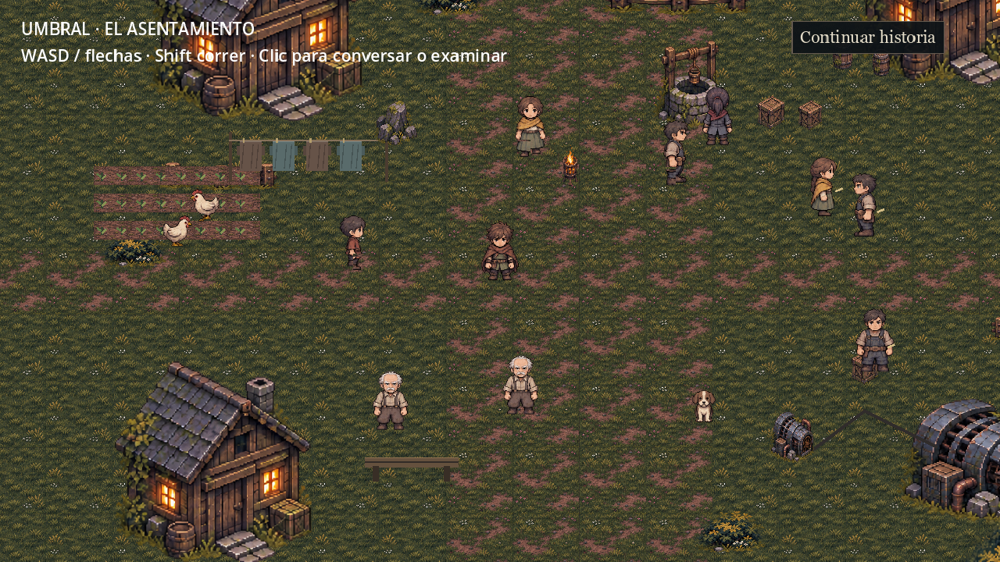
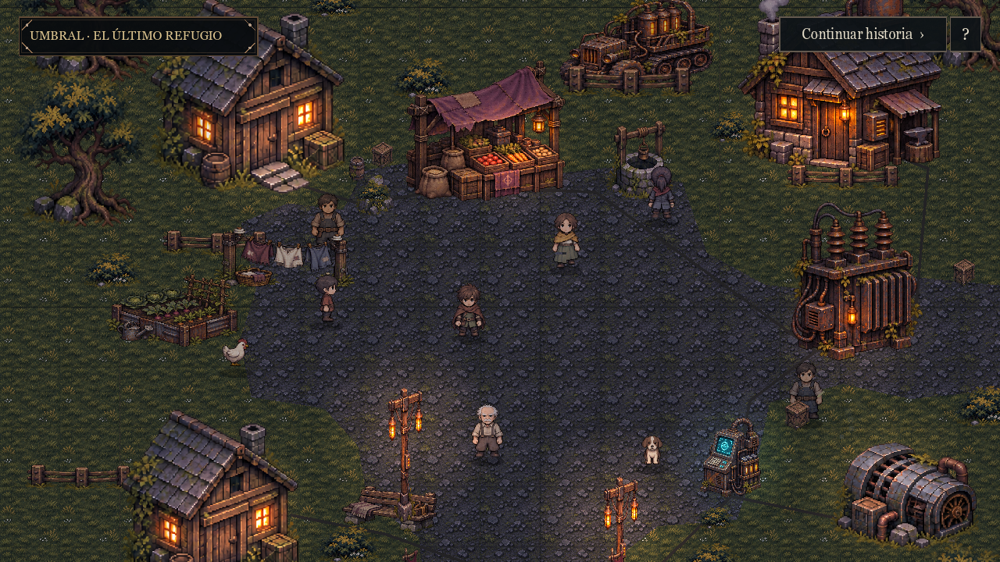
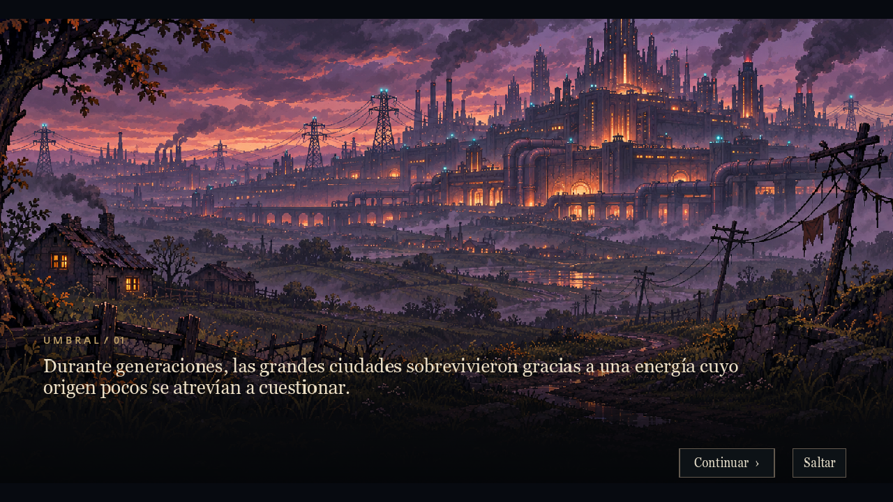
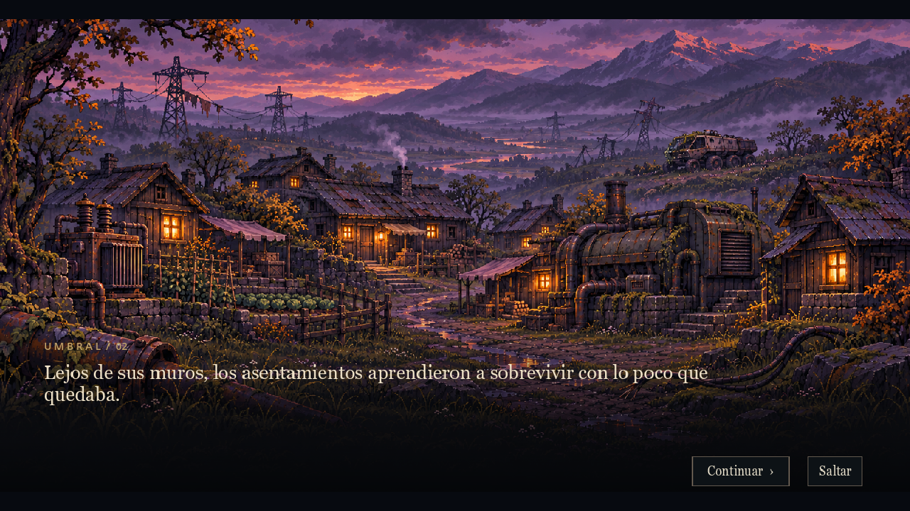
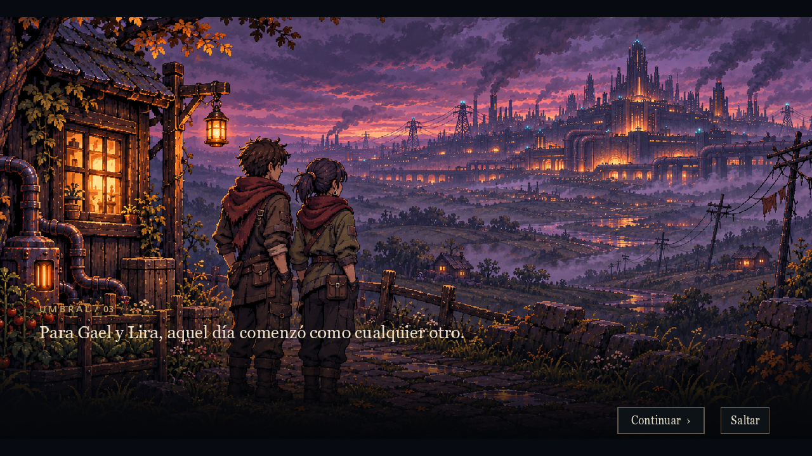
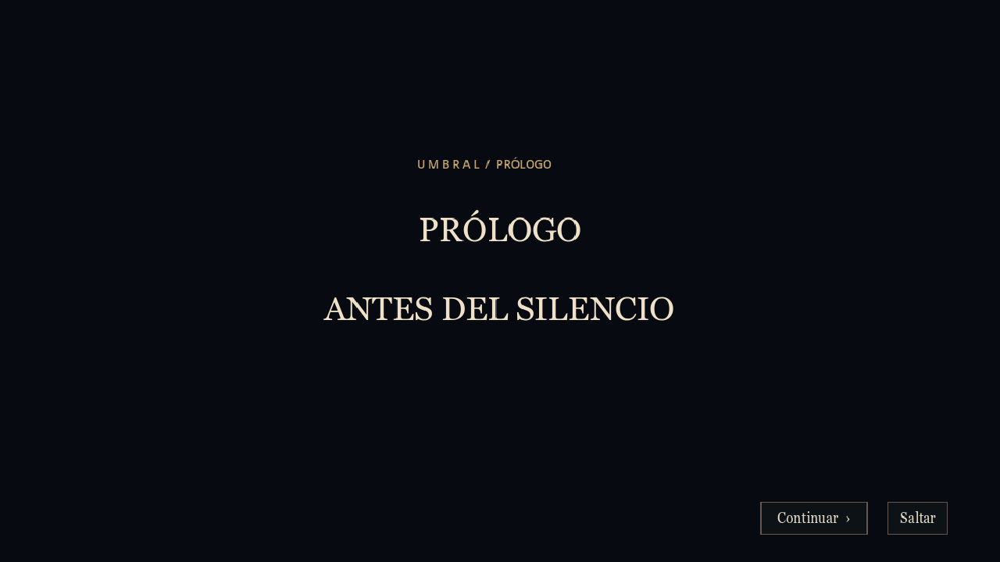

# Revisión visual — iteración 5

## Método y evidencia

Se abrió la referencia aprobada assets/references/486a0401-c42c-47e2-8b21-55ad25ebc5e0.png con view_image, tras comprobar que la ruta sin extensión no existe y localizar el archivo PNG. Se comparó con la exploración de iteración 4 (story_routines.png) antes de modificar archivos. La referencia no se recortó ni se usó como mapa.

Se ejecutaron capturas dentro de Godot 4.2.2, Compatibility/OpenGL en NVIDIA RTX 4060. test_iteration5_visual.gd recorrió ciudad, asentamientos, hermanos, título, salto, mundo, ayuda y terminal. Se inspeccionaron las imágenes del render, además de los assets originales. No se realizó una sesión manual continua; la prueba gráfica automatizada y la física headless son evidencias distintas.

## Comparación con el estándar aprobado

| Criterio | Escena anterior | Resultado implementado | Límite / diferencia |
|---|---|---|---|
| Composición | Césped continuo, casas desconectadas/cortadas, habitantes dispersos | Plaza central con contorno irregular, viviendas/puesto/pozo en sus bordes, caminos hasta terminal/entrada | Empedrado más uniforme y composición menos densa que el concepto |
| Arquitectura | Viviendas repetidas y separadas | Casas existentes agrupadas, taller nuevo con depósito/ventilación, cerco y mobiliario doméstico | Se reutiliza un modelo de vivienda en dos lugares; no todo edificio es único |
| Tecnología | Generador en un extremo y terminal pequeña | Transformador, consola, acumulador sobre vehículo, taller tecnológico, generador y red de cables conectados | Mayor peso tecnológico que el concepto, deliberado; sin convertirlo en fábrica |
| Habitantes | Varias copias cercanas del mismo aspecto | Ocho NPC activos y Gael, ubicados por función; cuatro reservas conservadas; tintes/ocupación separan trabajador y vecino | Los arquetipos y el rig de animación siguen compartidos, sin nuevos frames dibujados |
| Luz | Poca jerarquía, suelo iluminado casi uniformemente | Base fría, ventanas/faroles cálidos, terminal cian, vapor y oscilación luminosa discretos | No hay sombras de oclusión dinámicas ni iluminación normal-map |
| Vegetación | Hierba ocupando casi todo el encuadre | Bordes vegetales, huerto, árbol que cierra residencia y musgo en maquinaria | Se conserva el atlas de suelo anterior; no es una réplica píxel por píxel |
| Interfaz | Título/instrucciones grandes permanentes | Etiqueta pequeña, continuación discreta y ayuda ?, paneles negro/dorado existentes | Diálogos mantienen su tamaño anterior para legibilidad |
| Prólogo | Texto sobre props ampliados | Tres ilustraciones originales coherentes, texto progresivo, pan/zoom/fundidos, título y salto | Música nueva y animación interna de las ilustraciones no se añadieron; movimiento por capas/cámara |

## Capturas

Antes, conservado como evidencia histórica:

Resultado capturado después de activar rutinas:

Prólogo renderizado:

Ayuda y terminal: screenshots/iteration5_help.png y iteration5_terminal.png. Las capturas son evidencia/documentación; no forman parte del mapa jugable.

## Recursos usados y nivel de acabado

- Nuevos atlas originales: refuge_props.png (1536×1024, seis props) y refuge_domestic.png (2172×724, tres props). Se verificó alfa cero en márgenes; regiones calculadas a partir de dimensiones reales e inspeccionadas dentro del juego.
- Tres ilustraciones originales de 1672×941 en assets/art/cinematics/. Se generaron con la herramienta integrada image_gen, usando el skill imagegen y referencias solo de estilo/identidad. Prompts completos en ART_ITERATION_5_PROMPTS.json.
- Conservados: atlas de terreno, viviendas, cercas/vegetación/generador, sprites direccionales, sprites/retratos tácticos y sonidos. No se editaron bitmaps mediante scripts ni se extrajeron partes de la referencia.
- Huerto, ropa y banco geométricos de la versión anterior se sustituyeron en el contenido activo por los sprites nuevos. El renderer antiguo conserva compatibilidad con datos anteriores, pero no los presenta como arte final.
- Los nuevos props e ilustraciones están integrados, no son cuadrados ni iconos de sustitución. La calidad está comprobada en capturas; la aprobación artística final y el playtesting humano siguen siendo evaluación del usuario, no una consecuencia de compilar.
- El rig por piezas de personajes heredado continúa provisional. Se mejoró sincronización de pasos y anclaje con sombra; para animación final serían necesarios fotogramas dibujados. No se presenta como un spritesheet multiframe acabado.
